# Detecção de Vagas Disponíveis em Estacionamentos por Processamento Digital de Imagens

[](https://www.python.org/downloads/)
[](https://opencv.org/)
[](https://pytest.org/)
[](LICENSE)

Projeto Aplicado Longitudinal desenvolvido no curso de Ciência da Computação na disciplina de **Processamento Digital de Imagens (PDI)** — período **2026-02**.

---

## 1. Integrantes da Equipe e Responsabilidades

| Integrante | Papel Principal | Contribuições na M2 |
|---|---|---|
| **João Matheus de Oliveira Vieira** | Engenharia de PDI & Pipeline | Implementação do pipeline de PDI (`processamento.py`, `pipeline.py`, `delimitador_vagas.py`), operações de Canny, morfologia matemática, componentes conexos e suíte de testes com `pytest`. |
| **Maria Eduarda de Melo Honorato** | Pesquisa Experimental & Avaliação | Concepção do protocolo experimental, rotulagem manual de referência (`annotations/rotulos.csv`), módulo `experimentos.py`, validação cruzada LOIO, análise quantitativa e diagnóstico de erros. |
| **Scheila Carolini da Silva Ceresa** | Interface, Reprodutibilidade & Docs | Desenvolvimento da interface desktop Tkinter (`interface.py`), documentação técnica (`docs/relatorio_m2.md`, `docs/PROPOSTA.md`, `docs/revisao_m1_plano_m2.md`), gestão de dependências e revisão de qualidade. |

---

## 2. Visão Geral e Contexto de Aplicação

Em centros urbanos, aeroportos, shopping centers e campi universitários, a busca por vagas de estacionamento gera congestionamentos internos, aumento no consumo de combustível e emissão desnecessária de poluentes.

O objetivo deste projeto é desenvolver e validar uma solução em **Python e OpenCV** capaz de determinar em tempo real se vagas individuais de estacionamento estão **livres (0)** ou **ocupadas (1)** a partir de imagens capturadas por câmeras fixas de monitoramento.

A solução foca em técnicas clássicas e eficientes de Processamento Digital de Imagens:
- **Pré-processamento:** Escala de cinza e suavização gaussiana (com equalização adaptativa CLAHE opcional).
- **Segmentação:** Detecção de bordas pelo algoritmo de Canny.
- **Morfologia Matemática:** Fechamento elíptico (para união de segmentos veiculares) e abertura (eliminação de ruído isolado).
- **Análise de Componentes Conexos:** Rotulagem 8-conexa com descarte de componentes espúrios de pequena área.
- **Extração de Descritores:** Comparação sistemática entre 5 atributos de imagem.
- **Classificação:** Decisão por limiar ótimo calibrado experimentalmente.

---

## 3. Evolução Longitudinal do Projeto (M1 → M2)

Na **M1**, foi apresentada uma proposta inicial em Java propondo simultaneamente a localização automática das vagas e sua classificação. A devolutiva da M1 destacou a necessidade de focar o escopo, utilizar parâmetros fundamentados nas imagens e demonstrar viabilidade com código e dados reais.

A equipe registrou a revisão detalhada em [`docs/revisao_m1_plano_m2.md`](docs/revisao_m1_plano_m2.md) e na proposta [`docs/PROPOSTA.md`](docs/PROPOSTA.md), implementando na **M2**:

1. **Linguagem & Ecossistema:** Transição de Java para **Python 3**, integrando OpenCV, NumPy, Matplotlib e Pytest.
2. **Delimitação Geométrica Estável:** Coordenadas manuais precisas persistidas em formato JSON (`annotations/vagas.json`), isolando a classificação de ocupação contra ruídos externos (como a grama e veículos de outras fileiras).
3. **Parâmetros Baseados em Dados:** Todos os parâmetros numéricos (filtros, limiares de Canny, raios morfológicos e limiares de decisão) foram obtidos através de experimentos empíricos com o dataset.
4. **Validação Rigorosa:** Protocolo formal com Matriz de Confusão, Acurácia, Precisão, Revocação, Especificidade, F1-Score e validação cruzada *Leave-One-Image-Out* (LOIO).
5. **Interface Gráfica e Pipeline:** Executável via interface interativa em Tkinter (`interface.py`) ou por scripts CLI desacoplados.

---

## 4. Conjunto de Imagens e Dados

O projeto utiliza o dataset acadêmico de referência **PKLot**:
- **Referência:** DE ALMEIDA, P. R. L. et al. *PKLot – A robust dataset for parking lot classification*. Expert Systems with Applications, v. 42, n. 11, p. 4937–4949, 2015.
- **Subconjunto:** Câmera fixa elevada da **PUCPR** (Curitiba/PR).
- **Imagens disponíveis:** 5 imagens em alta resolução (1280 × 720 pixels, BGR sem compressão destrutiva):
  - `3.png`: Estacionamento vazio com luz suave, utilizada como imagem de calibração geométrica de referência.
  - `0.png`, `1.png`, `2.png`, `4.png`: Variação de iluminação direta, presença de sombras diagonais acentuadas e diferentes níveis de ocupação.
- **Amostras avaliadas:** 6 vagas de uma mesma fileira (`vaga_01` a `vaga_06`), totalizando **30 amostras** ($5 \text{ imagens} \times 6 \text{ vagas}$).
- **Ground Truth:** Rótulos manuais em [`annotations/rotulos.csv`](annotations/rotulos.csv), contendo **7 vagas ocupadas** e **23 vagas livres**.

---

## 5. Pipeline de Processamento Digital de Imagens

O pipeline técnico implementado percorre um fluxo completo e reproduzível:

```mermaid
flowchart LR
    A["Imagem PKLot (1280x720)"] --> B["Recorte de ROIs (vagas.json)"]
    B --> C["Escala de Cinza"]
    C --> D["Suavização Gaussiana (5x5)"]
    D --> E["Canny (50, 150)"]
    E --> F["Morfologia (Fech. 5x5 + Aber. 3x3)"]
    F --> G["Componentes Conexos (>= 20 px)"]
    G --> H["Extração de Atributos"]
    H --> I["Decisão: densidade_bordas >= 0.076"]
    I --> J["Saída Visual e Tabelas"]
```



### Detalhamento das Etapas:
1. **Recorte da Região de Interesse (ROI):** As coordenadas do JSON fatiam a submatriz da vaga preservando a resolução nativa.
2. **Conversão para Tons de Cinza:** Conversão ponderada ITU-R BT.601 ($Y = 0.299R + 0.587G + 0.114B$).
3. **Filtro Gaussiano ($5 \times 5$):** Convolução para atenuação de ruído de alta frequência sem desfocar bordas estruturais.
4. **Detecção de Bordas Canny:** Gradiente direcional com limiares de histerese $T_{low} = 50$ e $T_{high} = 150$.
5. **Morfologia Matemática:**
   - **Fechamento ($5 \times 5$, elíptico):** Conecta bordas de contorno quebradas e vincos do veículo.
   - **Abertura ($3 \times 3$, elíptico):** Elimina ruídos isolados remanescentes da textura do asfalto.
6. **Análise de Componentes Conexos:** Rotulagem 8-conexa (`cv2.connectedComponentsWithStats`) descartando componentes com menos de 20 pixels.
7. **Extração de Características:**
   - `densidade_bordas`: Proporção de pixels de borda (Canny) sobre a área total da ROI. *(Atributo principal selecionado)*
   - `area_mascara`: Proporção de pixels ativos após a morfologia.
   - `desvio_padrao`: Desvio-padrão dos níveis de cinza da ROI.
   - `maior_componente`: Área do maior componente conexo normalizada pela área da ROI.
   - `num_componentes`: Quantidade de componentes conexos válidos na ROI.
8. **Classificação por Limiar:** Se $\text{densidade\_bordas} \ge 0.076$, a vaga é considerada **ocupada (1)**; caso contrário, **livre (0)**.

---

## 6. Resultados Experimentais da M2

### 6.1 Matriz de Confusão (30 Amostras)

Configuração padrão: `densidade_bordas >= 0.076`, Gaussian Blur $5 \times 5$, Canny 50/150, fechamento $5 \times 5$, abertura $3 \times 3$, área mínima 20 px.

| Condição Real \ Classificação Prevista | Prevista Ocupada (1) | Prevista Livre (0) | Total |
|---|---|---|---|
| **Real Ocupada (1)** | **VP = 6** | **FN = 1** | 7 |
| **Real Livre (0)** | **FP = 0** | **VN = 23** | 23 |
| **Total** | 6 | 24 | **30** |

### 6.2 Indicadores Quantitativos Consolidados

| Métrica | Valor Obtido | Descrição |
|---|---|---|
| **Acurácia** | **96,7% (0.967)** | 29 acertos em 30 vagas analisadas |
| **Precisão** | **100,0% (1.000)** | Nenhuma vaga livre foi incorretamente apontada como ocupada |
| **Revocação (Recall)** | **85,7% (0.857)** | 6 das 7 vagas ocupadas foram detectadas |
| **Especificidade** | **100,0% (1.000)** | Todas as 23 vagas livres foram identificadas corretamente |
| **F1-Score** | **92,3% (0.923)** | Média harmônica entre Precisão e Revocação |
| **Acurácia LOIO** | **93,3% (0.933)** | Validação cruzada *Leave-One-Image-Out* (sem viés de ajuste) |
| **F1-Score LOIO** | **83,3% (0.833)** | Desempenho em imagem nunca vista na calibração |

### 6.3 Desempenho por Imagem

| Imagem | Acertos | Acurácia Local | Condições Observadas |
|---|---|---|---|
| `0.png` | 6 / 6 | 100% | 1 veículo, sombra suave, asfalto limpo |
| `1.png` | 6 / 6 | 100% | 3 veículos, forte reflexo do sol |
| `2.png` | 5 / 6 | 83,3% | 3 veículos; veículo escuro na vaga 05 |
| `3.png` | 6 / 6 | 100% | 100% livre (imagem de calibração) |
| `4.png` | 6 / 6 | 100% | 100% livre, sombra diagonal pronunciada |

### 6.4 Comparação Entre Atributos de PDI

| Atributo Avaliado | Limiar Ótimo | Acurácia Aparente | F1-Score | Erros | Acurácia LOIO | F1 LOIO |
|---|---|---|---|---|---|---|
| **`densidade_bordas`** | **0.0764** | **96.67%** | **0.9231** | **1** | **93.33%** | **0.8333** |
| `area_mascara` | 0.1056 | 93.33% | 0.8571 | 2 | 90.00% | 0.7692 |
| `desvio_padrao` | 43.514 | 90.00% | 0.8000 | 3 | 80.00% | 0.5714 |
| `maior_componente` | 0.0839 | 90.00% | 0.7273 | 3 | 90.00% | 0.7273 |
| `num_componentes` | 4.500 | 83.33% | 0.4444 | 5 | 76.67% | 0.2222 |

> **Gráficos gerados:** As figuras de separabilidade e dispersão estão disponíveis em [`data/experimentos/dispersao_caracteristicas.png`](data/experimentos/dispersao_caracteristicas.png) e [`data/experimentos/separacao_atributos.png`](data/experimentos/separacao_atributos.png).

### 6.5 Análise de Falhas e Casos Difíceis
- **O único Falso Negativo (FN — Imagem `2.png`, Vaga `vaga_05`):** Um veículo de lataria escura estacionado sobre piso de asfalto escuro apresentou valor de `densidade_bordas` igual a **0.0226** (abaixo do limiar de 0.076). A baixa reflectância e a ausência de contraste de cor com o pavimento não geraram gradientes suficientes no Canny.
- **Robustez contra Sombras (Imagem `4.png`, Vaga `vaga_01`):** Embora uma sombra forte corte a vaga vazia, o desvio padrão subiu para 32.01, mas a `densidade_bordas` manteve-se baixa (0.0196), provando que o gradiente de borda do Canny é muito mais robusto à variação de iluminação do que a intensidade pura dos pixels.

---

## 7. Estrutura do Repositório

```text
Estacionamento_Projeto/
├── README.md                      # Síntese e guia técnico completo do projeto
├── pytest.ini                     # Configuração padronizada para execução dos testes
├── requirements.txt               # Dependências fixadas do projeto
├── interface.py                   # Interface gráfica desktop em Tkinter
├── Diagrama_Arquitetura_M1.md     # Diagrama conceitual da M1
├── Diagrama_Arquitetura_M2.md     # Diagrama de arquitetura da M2
├── Diagrama_Pipeline_M1.jpg       # Imagem do pipeline da M1
├── Diagrama_Pipeline_M2.md        # Diagrama do pipeline da M2
├── annotations/
│   ├── vagas.json                 # Coordenadas geométricas das vagas delimitadas
│   └── rotulos.csv                # Rótulos Ground Truth das 30 amostras
├── data/
│   ├── experimentos/              # Tabelas CSV, relatórios e gráficos do experimentos.py
│   └── results/                   # Imagens classificadas, mosaicos intermediários e métricas
├── docs/
│   ├── PROPOSTA.md                # Proposta técnica atualizada
│   ├── revisao_m1_plano_m2.md     # Auditoria da devolutiva M1 e plano de ação M2
│   └── relatorio_m2.md            # Relatório técnico completo da etapa M2
├── images/
│   ├── input/                     # Imagens originais de entrada do PKLot (0.png a 4.png)
│   └── output/                    # Recortes individuais e imagem com delimitações
├── src/
│   └── estacionamento/
│       ├── __init__.py
│       ├── __main__.py            # Validação e leitura rápida de imagem
│       ├── leitor_imagens.py      # Carregamento e validação dimensional
│       ├── delimitador_vagas.py   # Gerenciamento de coordenadas e extração de ROIs
│       ├── anotar_vagas.py        # Ferramenta interativa de seleção de vagas
│       ├── processar_vagas.py     # Script em lote para recortes e delimitações
│       ├── rotular_vagas.py       # Ferramenta interativa de rotulagem manual
│       ├── processamento.py       # Operações centrais de PDI e extração de descritores
│       ├── pipeline.py            # Execução completa do pipeline e classificação
│       └── experimentos.py        # Suíte de experimentos comparativos e LOIO
└── tests/
    ├── test_leitor_imagens.py     # Testes do leitor e dimensões
    ├── test_delimitador_vagas.py  # Testes de persistência JSON e recorte de ROIs
    ├── test_processamento.py      # Testes de Canny, morfologia e componentes conexos
    ├── test_pipeline.py           # Testes de argumentos, painéis e execução end-to-end
    └── test_experimentos_e_metricas.py # Testes de matriz de confusão, métricas e LOIO
```

---

## 8. Instalação e Preparação do Ambiente

### Requisitos
- **Python 3.10 ou superior**
- Sistema operacional: Linux, macOS ou Windows

### 1. Clonar o repositório
```bash
git clone https://github.com/duda-honorato/M1_Pt1.git
cd M1_Pt1
```

### 2. Criar e ativar o ambiente virtual

**No Linux / macOS:**
```bash
python3 -m venv .venv
source .venv/bin/activate
```

**No Windows (CMD / PowerShell):**
```bash
py -m venv .venv
.venv\Scripts\activate
```

### 3. Instalar as dependências
```bash
pip install -r requirements.txt
```

---

## 9. Instruções de Execução

### Opção A — Interface Gráfica Interativa (Recomendado)
A interface Tkinter reúne execução de testes, pipeline, experimentos e visualização de métricas:

```bash
python interface.py
```
*(No Windows, também é possível executar com `py interface.py`)*

Recursos da Interface:
- **Rodar testes:** Dispara a suíte de testes com `pytest` sem travar a interface.
- **Processar todas as imagens:** Executa o pipeline com os parâmetros da tela e exibe as tabelas de métricas no log.
- **Rodar experimentos:** Executa os 5 experimentos comparativos e gera as curvas de dispersão.
- **Executar tudo:** Sequência automática completa (*testes → recortes → pipeline → experimentos*).
- **Abrir pastas:** Atalhos para visualizar os resultados e recortes gerados.

---

### Opção B — Execução dos Testes Automatizados
Graças ao arquivo [`pytest.ini`](pytest.ini), basta executar:

```bash
pytest -v
```
*(46 testes automatizados cobrindo todos os módulos do projeto)*

---

### Opção C — Linha de Comando (CLI)

#### 1. Executar o Pipeline Completo de Classificação
```bash
python -m estacionamento.pipeline \
  --input images/input \
  --annotations annotations/vagas.json \
  --labels annotations/rotulos.csv \
  --output data/results \
  --atributo densidade_bordas \
  --limiar 0.076
```

#### 2. Executar os Experimentos Comparativos
```bash
python -m estacionamento.experimentos \
  --input images/input \
  --annotations annotations/vagas.json \
  --labels annotations/rotulos.csv \
  --output data/experimentos
```

#### 3. Gerar Recortes e Imagens Delimitadas
```bash
python -m estacionamento.processar_vagas \
  --input images/input \
  --annotations annotations/vagas.json \
  --output images/output
```

#### 4. Delimitar Novas Vagas (Interativo no OpenCV)
```bash
python -m estacionamento.anotar_vagas \
  --input images/input/3.png \
  --annotations annotations/vagas.json \
  --output images/output \
  --quantidade 6
```

---

## 10. Saídas Geradas pelo Projeto

Ao executar o pipeline, os seguintes artefatos são gravados em `data/results/`:
- `caracteristicas.csv`: Tabela com todos os 5 atributos calculados para cada vaga, rótulo real e classe prevista.
- `parametros.json`: Registro fiel de todos os hiperparâmetros utilizados na execução.
- `<imagem>_classificada.png`: Imagem original anotada com caixas **verdes (livre)** e **vermelhas (ocupada)**.
- `intermediarias/<imagem>_<vaga>_etapas.png`: Mosaico lado a lado exibindo a ROI colorida, escala de cinza, bordas de Canny, resultado morfológico e mapa de componentes conexos coloridos.
- `metricas.txt`: Matriz de confusão, métricas quantitativas, acertos por imagem e lista detalhada de eventuais erros.

---

## 11. Limitações Conhecidas e Riscos Técnicos

- **Contraste de veículos escuros com asfalto:** Carros pretos ou cinza-chumbo sob iluminação uniforme geram poucas bordas de Canny, podendo causar falsos negativos se analisados apenas por densidade de bordas.
- **Variações extremas de iluminação:** Sombras densas que cubram parcialmente a vaga podem gerar bordas lineares no asfalto.
- **Dependência de câmera estática:** Coordenadas fixas exigem que a câmera não sofra deslocamentos ou vibrações intensas de vento.
- **Oclusão e enquadramento:** Veículos estacionados fora das demarcações ou oclusões parciais por árvores ou postes.

---

## 12. Plano de Continuidade para a Etapa M3

Para a etapa final (**M3**), o grupo planejou as seguintes ações concretas:

| Tarefa | Responsável | Prazo | Evidência de Conclusão |
|---|---|---|---|
| **Ampliação do Dataset:** Inclusão de imagens adicionais do PKLot em diferentes climas (chuva, nublado, sol pleno). | João Matheus | 10/11/2026 | Imagens e ground truth expandidos no repositório |
| **Fusão Multivariada de Características:** Combinação de bordas Canny com canais de cor (HSV) e descritores de textura (GLCM / LBP). | Maria Eduarda | 17/11/2026 | Script de extração e análise de ganho de informação |
| **Classificadores Aprendidos:** Comparação do limiar simples contra classificadores supervisionados (SVM e Random Forest com scikit-learn). | João Matheus | 24/11/2026 | Matriz de confusão comparativa e curvas ROC |
| **Detecção e Ajuste Automático de Vagas:** Estabilização de coordenadas em caso de tremor de câmera por detecção de linhas de demarcação. | Scheila | 01/12/2026 | Módulo de alinhamento geométrico |
| **Consolidação de Relatório Final e Vídeo da M3:** Redação do relatório M3 e gravação da apresentação final. | Todos | 10/12/2026 | `docs/relatorio_m3.md` e vídeo final no YouTube |

---

## 13. Vídeos do Projeto

- **Vídeo da Etapa M1 (Apresentação da Proposta):**  
  [https://youtu.be/5l5vSYWoiJw](https://youtu.be/5l5vSYWoiJw)
- **Vídeo da Etapa M2 (Demonstração da Implementação e Resultados):**  
  `[Link não listado do YouTube a ser adicionado após a gravação]`  
  *Roteiro da apresentação: Evolução desde a M1, demonstração da interface gráfica, execução dos 46 testes com pytest, inspeção dos recortes e saídas intermediárias, análise dos gráficos de experimentos e discussão do plano para M3.*

---

## 14. Uso Ético e Declarado de Inteligência Artificial Generativa

Conforme determinado nas diretrizes da disciplina, declara-se com transparência o uso de modelos de linguagem:

| Ferramenta | Finalidade | Material Produzido ou Modificado | Procedimento de Verificação |
|---|---|---|---|
| **Google Antigravity / Claude 3.5 Sonnet / Gemini** | Apoio na estruturação da suíte ampliada de testes unitários (`pytest`), organização técnica de tabelas em Markdown e sugestões de layout da interface gráfica Tkinter. | Arquivos `tests/test_*.py`, seções do `README.md` e formatação do `relatorio_m2.md`. | Todos os testes e scripts foram executados localmente e validados integralmente pelos integrantes da equipe, assegurando domínio completo do código. |

---

## 15. Referências Bibliográficas

1. CANNY, J. A computational approach to edge detection. **IEEE Transactions on Pattern Analysis and Machine Intelligence**, v. PAMI-8, n. 6, p. 679–698, 1986.
2. DE ALMEIDA, P. R. L.; OLIVEIRA, L. S.; BRITTO JR., A. S.; SILVA JR., E. J.; KOERICH, A. L. PKLot – A robust dataset for parking lot classification. **Expert Systems with Applications**, v. 42, n. 11, p. 4937–4949, 2015.
3. GONZALEZ, R. C.; WOODS, R. E. **Processamento Digital de Imagens**. 3. ed. São Paulo: Pearson Prentice Hall, 2010.
4. OPENCV. **OpenCV Documentation**. Disponível em: <https://docs.opencv.org/>. Acesso em: out. 2026.
5. ZUIDERVELD, K. Contrast limited adaptive histogram equalization. In: HECKBERT, P. (Ed.). **Graphics Gems IV**. San Diego: Academic Press, 1994. p. 474–485.
