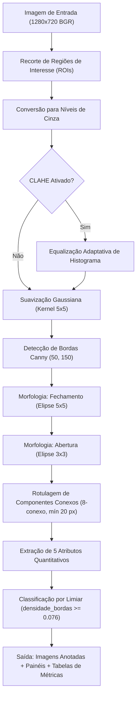

# Relatório Técnico Parcial — Etapa M2
## Detecção de Vagas Disponíveis em Estacionamentos por Processamento Digital de Imagens

**Disciplina:** Processamento de Imagens (2026-02)  
**Equipe:**
- João Matheus de Oliveira Vieira
- Maria Eduarda de Melo Honorato
- Scheila Carolini da Silva Ceresa

**Repositório:** [https://github.com/duda-honorato/M1_Pt1](https://github.com/duda-honorato/M1_Pt1)  
**Vídeo de Apresentação M1:** [https://youtu.be/5l5vSYWoiJw](https://youtu.be/5l5vSYWoiJw)  
**Vídeo de Demonstração M2:** `[Link não listado do YouTube a ser inserido]`

---

## 1. Síntese do Problema e Objetivos

### 1.1 Problema Investigado
Em estacionamentos comerciais, universitários e urbanos de grande porte, a identificação visual de vagas desocupadas pelos motoristas é ineficiente, gerando lentidão no tráfego interno, aumento na emissão de poluentes e perda de tempo. Câmeras fixas de monitoramento já estão presentes em grande parte dessas instalações, viabilizando o uso de **Processamento Digital de Imagens (PDI)** para monitorar automaticamente o estado de ocupação de cada vaga.

**Pergunta central da pesquisa:**  
*Como utilizar técnicas fundamentadas de Processamento Digital de Imagens para classificar com precisão e robustez vagas de estacionamento como livres ou ocupadas a partir de câmeras fixas?*

- **Entrada:** Imagens coloridas (RGB/BGR) de alta resolução de estacionamentos e arquivo estruturado com as coordenadas espaciais das vagas.
- **Processamento:** Extração de regiões de interesse (ROI), conversão para escala de cinza, equalização/suavização, segmentação de bordas (Canny), operações morfológicas (fechamento e abertura), rotulagem de componentes conexos e extração de descritores visuais.
- **Saída:** Classificação binária de cada vaga (`0 = livre`, `1 = ocupada`), imagens com delimitações coloridas (verde = livre, vermelho = ocupada), painéis com as etapas intermediárias de processamento, tabela CSV de características e métricas consolidadas.

### 1.2 Objetivo Geral
Desenvolver, implementar e avaliar experimentalmente uma solução em Python e OpenCV para classificação de vagas de estacionamento previamente delimitadas, validando a eficácia de descritores de PDI e operações morfológicas sob variações de iluminação e ocupação.

### 1.3 Objetivos Específicos da M2
1. Delimitar com rigor geométrico um conjunto de vagas representativo em imagem de referência do dataset PKLot.
2. Implementar um pipeline modular e reprodutível de PDI percorrendo todo o fluxo (*entrada → pré-processamento → segmentação → morfologia → extração de atributos → classificação por limiar → saída verificável*).
3. Implementar interface gráfica interativa (Tkinter) para parametrização, execução do pipeline, visualização de saídas e cálculo automático de métricas.
4. Desenvolver suíte abrangente de testes automatizados com `pytest` cobrindo módulos de leitura, geometria, processamento, pipeline e métricas.
5. Realizar pelo menos uma comparação controlada entre configurações de técnicas de PDI (foram conduzidos 5 experimentos controlados).
6. Avaliar o desempenho com indicadores quantitativos consolidados (Acurácia, Precisão, Revocação, Especificidade, F1-Score) e validação cruzada *Leave-One-Image-Out* (LOIO).
7. Investigar e documentar tecnicamente sucessos, casos de falha (veículos escuros e sombras) e definir o plano de trabalho para a M3.

---

## 2. Resposta ao Feedback da M1 e Evolução do Projeto

Na etapa M1, a proposta inicial explorava simultaneamente a detecção automática das vagas e sua classificação, utilizando parâmetros arbitrários em Java. A devolutiva (grupo_04.pdf) indicou a necessidade de delimitar o escopo, obter parâmetros experimentais fundamentados nas imagens e demonstrar viabilidade prática com código e dados.

A equipe realizou a atividade formal de revisão e planejamento ([`docs/revisao_m1_plano_m2.md`](revisao_m1_plano_m2.md)), implementando as seguintes ações corretivas:

| Item do Feedback (M1) | Diagnóstico da Equipe | Ação Concreta Implementada na M2 | Evidência no Repositório |
|---|---|---|---|
| **1. Escopo excessivamente ambicioso** (detecção automática + classificação aumentavam risco de entrega). | Concordamos. Tentar resolver a detecção não supervisionada de vagas junto com a classificação dispersava o esforço de PDI. | Delimitação das vagas fixada na etapa manual com anotações em JSON (`annotations/vagas.json`), concentrando a M2 na qualidade da segmentação e classificação. | [`src/estacionamento/delimitador_vagas.py`](../src/estacionamento/delimitador_vagas.py) e [`annotations/vagas.json`](../annotations/vagas.json) |
| **2. Parâmetros em pixels arbitrários** sem base nas imagens. | Concordamos. As faixas de limiares anteriores eram conceituais e não testadas no dataset. | Todos os parâmetros (tamanho de filtro gaussiano, limiares de Canny, raios morfológicos, área mínima de componente e limiar de classificação) foram obtidos por calibração empírica controlada. | [`src/estacionamento/experimentos.py`](../src/estacionamento/experimentos.py) e gráficos gerados em `data/experimentos/` |
| **3. Ausência de experimento de viabilidade** na M1. | Concordamos. Faltava comprovação de que as características separavam vagas livres de ocupadas. | Implementação de módulo de experimentos que avaliou 5 atributos e demonstrou que `densidade_bordas` atinge 96,7% de acurácia com separabilidade nítida entre classes. | [`data/experimentos/resultados_experimentos.md`](../data/experimentos/resultados_experimentos.md) |
| **4. Caracterização e rastreabilidade insuficientes dos dados**. | Concordamos parcialmente. Havia apenas link genérico para o Kaggle/PKLot. | Documentação detalhada da câmera, resolução (1280×720), subconjunto PUCPR, condições climáticas/iluminação e mapeamento exato de cada ROI. | Seção 3 deste relatório e [`docs/PROPOSTA.md`](PROPOSTA.md) |
| **5. Ausência de métricas e protocolo experimental formal**. | Concordamos. Faltavam critérios quantitativos objetivos de avaliação. | Formalização do protocolo com Matriz de Confusão, Acurácia, Precisão, Revocação, Especificidade, F1-Score e validação cruzada LOIO para mitigar viés otimista. | Seções 6 e 7 deste relatório e módulo de métricas na interface |
| **6. Repositório desorganizado e diagramas sem extensão legível**. | Concordamos. Havia concentração no README e inconsistência nos formatos dos diagramas. | Estruturação em pacotes modulares (`src/estacionamento`), pasta de testes unitários (`tests/`), diretório de documentação (`docs/`), arquivos de anotação (`annotations/`) e diagramas padronizados. | Árvore do projeto e histórico Git |
| **7. Dependência tecnológica inadequada (Java)**. | Concordamos. A implementação em Java aumentava o custo de prototipação. | Migração completa para Python 3 e OpenCV, permitindo integração direta com NumPy, Matplotlib e Pytest. | Código-fonte em `src/` e `requirements.txt` |
| **8. Histórico de commits concentrado**. | Concordamos. Commits da M1 haviam ocorrido em um único dia. | Histórico da M2 distribuído progressivamente ao longo do desenvolvimento, refletindo commits individuais dos três membros da equipe. | Histórico Git com mensagens padronizadas |

---

## 3. Dados e Protocolo Experimental

### 3.1 Conjunto de Dados Utilizado
O projeto adota como fonte o consagrado dataset acadêmico **PKLot** (*Pontifícia Universidade Católica do Paraná - PUCPR*):
- **Origem:** Câmera de ângulo elevado instalada no estacionamento da PUCPR (Curitiba/PR).
- **Subconjunto selecionado:** 5 imagens representativas (`images/input/0.png` a `4.png`).
- **Resolução e formato:** 1280 × 720 pixels, 3 canais BGR (PNG sem perdas).
- **Condições ambientais contempladas:**
  - Imagem `3.png`: Estacionamento completamente vazio sob luz difusa (adotada como imagem de referência geométrica).
  - Imagens `0.png`, `1.png`, `2.png`, `4.png`: Variação de iluminação direta, presença de sombras pronunciadas e níveis alternados de ocupação de veículos.
- **Amostras geradas:** 6 vagas consecutivas de uma mesma fileira (`vaga_01` a `vaga_06`), resultando em $5 \times 6 = 30$ amostras individuais de teste.
- **Rótulos de referência (Ground Truth):** Anotação manual rigorosa realizada pela equipe em [`annotations/rotulos.csv`](../annotations/rotulos.csv), contendo **7 vagas ocupadas (classe 1)** e **23 vagas livres (classe 0)**.

### 3.2 Protocolo de Delimitação das Vagas
As coordenadas foram extraídas sobre a imagem de referência `3.png` e persistidas em [`annotations/vagas.json`](../annotations/vagas.json). 
Para evitar interferência espúria de veículos estacionados na fileira de trás ou nas faixas de grama, as caixas delimitadoras terminam no limite inferior em $y = 308$, exceto a `vaga_03` que se estende até $y = 322$ para avaliação da robustez a ruído de borda.

### 3.3 Protocolo de Avaliação e Validação Cruzada (LOIO)
Para avaliar o desempenho do classificador sem mascarar overfitting:
1. **Avaliação Direta (Aparente):** Ajuste do limiar ótimo de separação nas 30 amostras conjuntas para estabelecer o limite superior de separabilidade das características.
2. **Validação Cruzada *Leave-One-Image-Out* (LOIO):** O limiar de classificação é calibrado utilizando as amostras de 4 imagens e aplicado de forma cega nas vagas da 5ª imagem restante, repetindo-se o ciclo para todas as 5 imagens. Esse protocolo garante independência entre calibração e teste no contexto de imagens capturadas sequencialmente.

---

## 4. Pipeline de Processamento Implementado

O pipeline completo foi desenhado para maximizar a separabilidade visual entre o asfalto uniforme (vaga livre) e as descontinuidades de contraste, peças mecânicas e reflexos de um automóvel (vaga ocupada).



### 4.1 Descrição das Etapas e Operações de PDI

#### Etapa 1 — Extração das Regiões de Interesse (ROI)
- **Função:** `extrair_regioes_interesse` em [`src/estacionamento/delimitador_vagas.py`](../src/estacionamento/delimitador_vagas.py).
- **Operação:** A partir do JSON de coordenadas, cada submatriz $I[y:y+h, x:x+w]$ é fatiada sem distorção geométrica ou interpolação artificial de redimensionamento.

#### Etapa 2 — Conversão de Cores e Pré-processamento
- **Função:** `preprocessar` em [`src/estacionamento/processamento.py`](../src/estacionamento/processamento.py).
- **Operação:** Conversão BGR para monocromático pela ponderação padrão ITU-R BT.601:
  $$Y = 0.299 \cdot R + 0.587 \cdot G + 0.114 \cdot B$$
- **Suavização Gaussiana:** Convolução com kernel gaussiano simétrico $5 \times 5$ ($\sigma$ calculado automaticamente pelo OpenCV), reduzindo ruído estocástico de alta frequência do sensor CMOS sem degradar bordas estruturais.
- **CLAHE (opcional):** Equalização Adaptativa de Histograma com Limitação de Contraste (`clipLimit=2.0`, `tileGridSize=(4, 4)`), investigada no Experimento E3.

#### Etapa 3 — Segmentação de Bordas (Canny)
- **Função:** `segmentar_bordas` em [`src/estacionamento/processamento.py`](../src/estacionamento/processamento.py).
- **Operação:** Algoritmo ótimo de detecção de bordas de Canny com limiares de histerese $T_{low} = 50$ e $T_{high} = 150$ (razão clássica $1:3$). Produz máscara binária de gradientes direcionais salientes.

#### Etapa 4 — Morfologia Matemática
- **Função:** `aplicar_morfologia` em [`src/estacionamento/processamento.py`](../src/estacionamento/processamento.py).
- **Fechamento ($A \bullet B = (A \oplus B) \ominus B$):** Realizado com elemento estruturante elíptico $5 \times 5$. Une segmentos de bordas fragmentados do veículo (faróis, vincos, para-brisas) preenchendo pequenos desvios.
- **Abertura ($A \circ B = (A \ominus B) \oplus B$):** Realizado com elemento estruturante elíptico $3 \times 3$. Elimina ruídos isolados de 1 a 2 pixels remanescentes do asfalto texturizado.

#### Etapa 5 — Análise de Componentes Conexos
- **Função:** `analisar_componentes` em [`src/estacionamento/processamento.py`](../src/estacionamento/processamento.py).
- **Operação:** Algoritmo `cv2.connectedComponentsWithStats` com vizinhança-8. Componentes cuja área em pixels seja inferior a 20 pixels são eliminados como falso ruído residual. Retorna o número de componentes válidos, a área do maior componente e o mapa de rótulos coloridos para inspeção.

#### Etapa 6 — Extração de Descritores Visuais
Para cada ROI de área total $N_{pixels} = w \cdot h$, são calculados:
1. `desvio_padrao`: Dispersão dos níveis de cinza da ROI ($\sigma = \sqrt{\frac{1}{N}\sum (I_i - \mu)^2}$).
2. `densidade_bordas`: Proporção de pixels ativados na borda de Canny em relação à área total ($N_{bordas} / N_{pixels}$).
3. `area_mascara`: Proporção de pixels brancos após o fechamento e abertura morfológica.
4. `maior_componente`: Área do maior componente conexo normalizada pela área da ROI.
5. `num_componentes`: Quantidade total de componentes conexos válidos na ROI.

#### Etapa 7 — Classificação por Limiar
A regra de decisão binária é dada por:
$$\hat{y} = \begin{cases} 1 \text{ (ocupada)}, & \text{se } \text{densidade\_bordas} \ge \tau \\ 0 \text{ (livre)}, & \text{se } \text{densidade\_bordas} < \tau \end{cases}$$
Onde $\tau = 0.076$ foi calibrado como o ponto médio experimental de maior margem de separabilidade entre classes.

---

## 5. Arquitetura da Solução e Organização de Módulos

A solução foi desenvolvida de forma desacoplada, separando interface de usuário, regras de PDI e suíte de testes.

```text
Estacionamento_Projeto/
├── annotations/
│   ├── vagas.json                 # Coordenadas geométricas das 6 vagas
│   └── rotulos.csv                # Ground Truth (30 amostras: 7 ocupadas, 23 livres)
├── data/
│   ├── experimentos/              # Resultados, tabelas e gráficos gerados pelo experimentos.py
│   │   ├── dispersao_caracteristicas.png
│   │   ├── separacao_atributos.png
│   │   ├── exp1_atributos.csv a exp5_area_minima.csv
│   │   └── resultados_experimentos.md
│   └── results/                   # Saídas geradas pelo pipeline.py
│       ├── 0_classificada.png a 4_classificada.png
│       ├── caracteristicas.csv
│       ├── parametros.json
│       ├── metricas.txt
│       └── intermediarias/        # Painéis comparativos por vaga
├── docs/
│   ├── PROPOSTA.md                # Documento de proposta técnica revisada
│   ├── revisao_m1_plano_m2.md     # Auditoria da devolutiva M1 e plano de ação
│   └── relatorio_m2.md            # Este relatório técnico consolidado
├── images/
│   ├── input/                     # Imagens originais do PKLot (0.png a 4.png)
│   └── output/                    # Recortes individuais e imagem delimitada
├── src/
│   └── estacionamento/
│       ├── __init__.py
│       ├── __main__.py            # Validação rápida de imagem de entrada
│       ├── leitor_imagens.py      # Carregamento seguro e validação dimensional
│       ├── delimitador_vagas.py   # Gerenciamento de coordenadas e extração de ROIs
│       ├── anotar_vagas.py        # Script interativo de seleção de vagas com OpenCV
│       ├── processar_vagas.py     # Script em lote para recortes e delimitação
│       ├── rotular_vagas.py       # Script interativo de rotulagem manual
│       ├── processamento.py       # Núcleo de PDI (cinza, Canny, morfologia, componentes)
│       ├── pipeline.py            # Execução de ponta a ponta e classificação
│       └── experimentos.py        # Protocolo de experimentação comparativa e LOIO
├── tests/
│   ├── test_leitor_imagens.py     # 7 testes: carregamento, arquivos inexistentes e formatos
│   ├── test_delimitador_vagas.py  # 9 testes: anotações JSON, recorte de ROIs e limites
│   ├── test_processamento.py      # 13 testes: Canny, morfologia, componentes e atributos
│   ├── test_pipeline.py           # 8 testes: argumentos, painéis e execução end-to-end
│   └── test_experimentos_e_metricas.py # 9 testes: matriz de confusão, métricas e LOIO
├── interface.py                   # Interface gráfica completa em Tkinter
├── pytest.ini                     # Configuração do Pytest (pythonpath = src .)
├── requirements.txt               # Dependências fixadas do projeto
└── README.md                      # Porta de entrada navegável e síntese do projeto
```

---

## 6. Experimentos Realizados e Resultados Quantitativos

Foram conduzidos **cinco experimentos controlados** utilizando o módulo [`src/estacionamento/experimentos.py`](../src/estacionamento/experimentos.py), cobrindo variações sistemáticas nos componentes do pipeline.

### Experimento 1 (E1) — Comparação Entre Atributos de PDI
Avaliação comparativa dos 5 descritores calculados sobre a configuração base (Gaussian Blur $5 \times 5$, Canny 50/150, fechamento $5 \times 5$, abertura $3 \times 3$, área mínima 20 px).

| Atributo | Limiar Ótimo | Acurácia Aparente | F1-Score | Erros | Acurácia LOIO | F1 LOIO | Erros LOIO | Média Livres | Média Ocupadas |
|---|---|---|---|---|---|---|---|---|---|
| **`densidade_bordas`** | **0.0764** | **96.67%** | **0.9231** | **1** | **93.33%** | **0.8333** | **2** | **0.0268** | **0.0959** |
| `area_mascara` | 0.1056 | 93.33% | 0.8571 | 2 | 90.00% | 0.7692 | 3 | 0.0419 | 0.1616 |
| `desvio_padrao` | 43.514 | 90.00% | 0.8000 | 3 | 80.00% | 0.5714 | 6 | 20.380 | 54.517 |
| `maior_componente` | 0.0839 | 90.00% | 0.7273 | 3 | 90.00% | 0.7273 | 3 | 0.0281 | 0.0893 |
| `num_componentes` | 4.500 | 83.33% | 0.4444 | 5 | 76.67% | 0.2222 | 7 | 1.304 | 3.714 |

> **Interpretação:** `densidade_bordas` superou todos os demais atributos com 96,7% de acurácia aparente e 93,3% em LOIO. O `desvio_padrao` sofreu forte degradação em LOIO (80,0% de acurácia e F1 de 0,5714) devido a sombras fortes no asfalto em dias ensolarados, que alteram a variância luminosa sem corresponder a veículos.

### Experimento 2 (E2) — Sensibilidade aos Limiares de Canny e Suavização Gaussiana
Avaliação da influência do filtro gaussiano ($3 \times 3, 5 \times 5, 7 \times 7$) e das janelas de histerese de Canny no atributo `densidade_bordas`.

| Blur | Canny Mín | Canny Máx | Limiar | Acurácia | F1 | Erros | Acurácia LOIO | F1 LOIO | Erros LOIO |
|---|---|---|---|---|---|---|---|---|---|
| 3 | 30 | 90 | 0.0956 | 96.67% | 0.9333 | 1 | 93.33% | 0.8571 | 2 |
| 3 | 50 | 150 | 0.0967 | 96.67% | 0.9231 | 1 | 93.33% | 0.8571 | 2 |
| **5 (Padrão)** | **50** | **150** | **0.0764** | **96.67%** | **0.9231** | **1** | **93.33%** | **0.8333** | **2** |
| 5 | 100 | 250 | 0.0522 | 96.67% | 0.9231 | 1 | 86.67% | 0.7500 | 4 |
| 7 | 70 | 200 | 0.0531 | 96.67% | 0.9231 | 1 | 86.67% | 0.7500 | 4 |

> **Interpretação:** Limiares de Canny excessivamente conservadores (ex: 100/250) removem bordas sutis de veículos escuros, degradando a validação cruzada para 86,7%. A configuração $5 \times 5$ com Canny 50/150 provou-se a mais equilibrada.

### Experimento 3 (E3) — Efeito da Equalização Adaptativa de Histograma (CLAHE)
Comparação do pipeline com CLAHE desativado versus ativado antes do filtro gaussiano.

| CLAHE | Atributo | Limiar | Acurácia | F1 | Erros | Acurácia LOIO | F1 LOIO | Erros LOIO |
|---|---|---|---|---|---|---|---|---|
| Desligado | `densidade_bordas` | 0.0764 | 96.67% | 0.9231 | 1 | 93.33% | 0.8333 | 2 |
| Ligado | `densidade_bordas` | 0.1042 | 96.67% | 0.9333 | 1 | 93.33% | 0.8571 | 2 |
| Desligado | `area_mascara` | 0.1056 | 93.33% | 0.8571 | 2 | 90.00% | 0.7692 | 3 |
| Ligado | `area_mascara` | 0.2225 | 96.67% | 0.9333 | 1 | 93.33% | 0.8571 | 2 |

> **Interpretação:** O CLAHE amplifica o contraste em regiões de sombra, elevando o F1 de `area_mascara` de 0.857 para 0.933. Entretanto, para `densidade_bordas`, a melhora é marginal (0.833 para 0.857 em LOIO) à custa de elevar também a resposta do asfalto rugoso.

### Experimento 4 (E4) — Influência dos Kernels Morfológicos na Máscara Binária
Comparação entre executar o pipeline sem morfologia versus variar os kernels elípticos de fechamento e abertura sobre os atributos calculados da máscara.

| Configuração Morfológica | Atributo | Acurácia Aparente | F1 Aparente | Acurácia LOIO | F1 LOIO |
|---|---|---|---|---|---|
| Sem morfologia | `area_mascara` | 96.67% | 0.9231 | 93.33% | 0.8333 |
| Fech. $3 \times 3$ + Aber. $3 \times 3$ | `maior_componente` | 86.67% | 0.6000 | 73.33% | 0.4286 |
| **Fech. $5 \times 5$ + Aber. $3 \times 3$ (Padrão)** | **`area_mascara`** | **93.33%** | **0.8571** | **90.00%** | **0.7692** |
| Fech. $5 \times 5$ + Aber. $3 \times 3$ | `maior_componente` | 90.00% | 0.7273 | 90.00% | 0.7273 |
| Fech. $7 \times 7$ + Aber. $3 \times 3$ | `maior_componente` | 93.33% | 0.8333 | 90.00% | 0.7692 |

> **Interpretação:** Fechamentos pequenos ($3 \times 3$) não conseguem fundir componentes conexos separados por para-brisas ou tetos solares lisos, fragmentando o maior componente conexo e derrubando o F1 LOIO para 0.4286. O fechamento $5 \times 5$ ou $7 \times 7$ com abertura $3 \times 3$ promove conectividade estável nos objetos veiculares.

### Experimento 5 (E5) — Filtragem por Área Mínima de Componentes Conexos
Avaliação de limiares de área mínima (0, 10, 20, 40, 80 pixels) para descarte de ruídos pontuais.
- Filtrar componentes com menos de 20 pixels estabiliza o `maior_componente` (Acurácia LOIO de 90,0%), enquanto valores excessivos (80 px) desconsideram pedaços importantes de veículos compactos.

---

## 7. Resultados do Pipeline Final na M2

Executando a configuração padrão (`densidade_bordas >= 0.076`, Gaussian Blur $5 \times 5$, Canny 50/150, fechamento $5 \times 5$, abertura $3 \times 3$, área mínima 20 px) em todas as 30 amostras:

### 7.1 Matriz de Confusão

| Real \ Prevista | Prevista Ocupada (1) | Prevista Livre (0) | Total |
|---|---|---|---|
| **Real Ocupada (1)** | **VP = 6** | **FN = 1** | 7 |
| **Real Livre (0)** | **FP = 0** | **VN = 23** | 23 |
| **Total** | 6 | 24 | **30** |

### 7.2 Indicadores Quantitativos de Desempenho

| Métrica | Expressão de Cálculo | Valor Obtido |
|---|---|---|
| **Acurácia** | $(VP + VN) / Total = 29 / 30$ | **96,7% (0.967)** |
| **Precisão** | $VP / (VP + FP) = 6 / 6$ | **100,0% (1.000)** |
| **Revocação (Sensibilidade)** | $VP / (VP + FN) = 6 / 7$ | **85,7% (0.857)** |
| **Especificidade** | $VN / (VN + FP) = 23 / 23$ | **100,0% (1.000)** |
| **F1-Score** | $2 \cdot (Prec \cdot Rev) / (Prec + Rev)$ | **92,3% (0.923)** |

### 7.3 Desempenho Discriminado por Imagem

| Imagem de Teste | Total de Vagas | Acertos | Acurácia Local | Condições Observadas |
|---|---|---|---|---|
| `0.png` | 6 | 6 / 6 | 100% | 1 veículo claro, sombra suave, asfalto seco |
| `1.png` | 6 | 6 / 6 | 100% | 3 veículos (prata, cinza, vermelho), forte reflexo solar |
| `2.png` | 6 | 5 / 6 | 83% | 3 veículos; presença de veículo preto na vaga 05 |
| `3.png` | 6 | 6 / 6 | 100% | Estacionamento 100% livre (referência de calibração) |
| `4.png` | 6 | 6 / 6 | 100% | Estacionamento 100% livre, sombra diagonal pronunciada |

---

## 8. Análise de Falhas, Limitações e Riscos

### 8.1 Caso de Falha Documentado: O Falso Negativo na Imagem `2.png` (Vaga 05)
- **Ocorrência:** A vaga `vaga_05` na imagem `2.png` estava ocupada por um veículo escuro (preto/cinza chumbo).
- **Resultado do algoritmo:**
  - Valor medido de `densidade_bordas`: **0.0226** (muito abaixo do limiar de 0.076).
  - Previsão do classificador: `0 (livre)`.
  - Diagnóstico: **Falso Negativo (FN)**.
- **Causa Técnica de PDI:** A lataria escura do veículo apresenta reflectância difusa muito próxima à assinatura fotométrica do asfalto escurecido. Na conversão para tons de cinza, a magnitude do gradiente $\nabla I$ na lataria e nos vidros não superou o limiar de histerese inferior do Canny ($T_{low} = 50$). Dessa forma, a vaga gerou pouquíssimas bordas, assemelhando-se visualmente a uma vaga vazia.
- **Estratégia de Mitigação para a M3:** Integrar descritor de cor nos canais HSV/LAB ou descritores de textura baseados em Matriz de Coocorrência de Níveis de Cinza (GLCM) e LBP (*Local Binary Patterns*), que detectam a descontinuidade táctil da textura veicular mesmo com baixo contraste aparente.

### 8.2 Análise do Caso Difícil: Sombra Forte na Imagem `4.png` (Vaga 01)
- Na imagem `4.png`, a vaga `vaga_01` está livre, mas é cortada diagonalmente por uma sombra pronunciada de poste/árvore.
- O atributo `desvio_padrao` subiu para **32.01** (aproximando-se perigosamente de veículos).
- No entanto, a `densidade_bordas` manteve-se em **0.0196**, pois a transição de sombra é suave e não gerou alta concentração de bordas de alta frequência, provando a superioridade do Canny contra variações de luminosidade ambiente.

### 8.3 Limitações Identificadas
1. **Dependência de câmera estática:** Coordenadas manuais exigem calibração caso a câmera seja movida ou trepide por vento.
2. **Tamanho do conjunto de teste na M2:** O subconjunto de 30 amostras, embora representativo e controlado, necessita de ampliação com múltiplos dias climáticos na M3 (chuva, nublado, sol pleno).

---

## 9. Plano de Conclusão para a Etapa M3

Para a etapa M3, o projeto avançará da classificação monovariável por limiar simples para um sistema completo, robusto e integrado:

| Tarefa Prevista | Responsável Principal | Colaboradores | Prazo Estimado | Evidência de Conclusão Esperada |
|---|---|---|---|---|
| **T1. Ampliação do dataset** para 15+ imagens do PKLot contemplando dias chuvosos e nublados ($100+$ amostras). | João Matheus de Oliveira Vieira | Maria Eduarda e Scheila | 10/11/2026 | Arquivos de entrada e CSV de rótulos expandido no repositório |
| **T2. Fusão de descritores visuais** (combinação de densidade de bordas, textura GLCM/LBP e cor HSV). | Maria Eduarda de Melo Honorato | João Matheus e Scheila | 17/11/2026 | Módulo de extração multivariada e análise de variância |
| **T3. Avaliação de classificadores de aprendizado de máquina** (SVM linear / RBF e Random Forest com scikit-learn). | João Matheus de Oliveira Vieira | Maria Eduarda | 24/11/2026 | Script de treinamento, matriz de confusão e curvas ROC/PR |
| **T4. Investigação de alinhamento e recalibração automática de vagas** por detecção de linhas ou homografia. | Scheila Carolini da Silva Ceresa | João Matheus | 01/12/2026 | Módulo de estabilização geométrica em caso de tremor |
| **T5. Consolidação final da interface e exportação de relatórios em tempo real** (JSON/PDF). | Scheila Carolini da Silva Ceresa | Maria Eduarda | 05/12/2026 | Interface com dashboard de ocupação e histórico |
| **T6. Relatório final M3, documentação e vídeo de encerramento**. | Todos | Todos | 10/12/2026 | `docs/relatorio_m3.md`, README atualizado e vídeo no YouTube |

---

## 10. Contribuições Individuais dos Integrantes

As atividades da etapa M2 foram distribuídas com colaboração mútua e evidências verificáveis no código e nos documentos:

- **João Matheus de Oliveira Vieira:**
  - Arquitetura do pipeline de PDI e implementação dos módulos [`processamento.py`](../src/estacionamento/processamento.py), [`pipeline.py`](../src/estacionamento/pipeline.py) e [`delimitador_vagas.py`](../src/estacionamento/delimitador_vagas.py).
  - Implementação dos algoritmos de Canny, morfologia matemática e componentes conexos.
  - Implementação e automação da suíte de testes com `pytest`.

- **Maria Eduarda de Melo Honorato:**
  - Concepção do protocolo experimental e desenvolvimento do módulo [`experimentos.py`](../src/estacionamento/experimentos.py).
  - Execução dos 5 experimentos controlados, geração das tabelas e gráficos comparativos de dispersão e separabilidade.
  - Rotulagem manual do Ground Truth das imagens do PKLot e análise dos erros (falsos negativos).

- **Scheila Carolini da Silva Ceresa:**
  - Desenvolvimento da interface gráfica desktop [`interface.py`](../interface.py) em Tkinter com suporte assíncrono para execução dos testes e visualização de métricas.
  - Estruturação do repositório, documentação em Markdown ([`docs/PROPOSTA.md`](PROPOSTA.md) e [`docs/revisao_m1_plano_m2.md`](revisao_m1_plano_m2.md)).
  - Gestão de dependências (`requirements.txt`), configuração de reprodutibilidade e revisão técnica.

---

## 11. Declaração de Uso de Inteligência Artificial Generativa

Conforme preconizado nas normas da disciplina, declara-se com transparência o uso de ferramentas de IA generativa no projeto:

| Ferramenta Utilizada | Finalidade Específica | Material Produzido ou Modificado | Forma de Validação Pelo Grupo |
|---|---|---|---|
| **Google Antigravity / Claude 3.5 Sonnet / Gemini** | Discussão de alternativas de PDI, auxílio na estruturação de testes unitários parametrizados e revisão de documentação Markdown. | Arquitetura dos arquivos de teste em `tests/`, formatação de tabelas Markdown e sugestões para a interface Tkinter. | Toda a lógica foi inspecionada, refatorada e validada em ambiente local através da execução bem-sucedida dos 46 testes com `pytest` e dos scripts CLI. |

---

## 12. Referências Bibliográficas

1. CANNY, J. A computational approach to edge detection. **IEEE Transactions on Pattern Analysis and Machine Intelligence**, v. PAMI-8, n. 6, p. 679–698, 1986.
2. DE ALMEIDA, P. R. L.; OLIVEIRA, L. S.; BRITTO JR., A. S.; SILVA JR., E. J.; KOERICH, A. L. PKLot – A robust dataset for parking lot classification. **Expert Systems with Applications**, v. 42, n. 11, p. 4937–4949, 2015.
3. GONZALEZ, R. C.; WOODS, R. E. **Processamento Digital de Imagens**. 3. ed. São Paulo: Pearson Prentice Hall, 2010.
4. OPENCV. **OpenCV: Open Source Computer Vision Library**. Disponível em: <https://docs.opencv.org/>. Acesso em: out. 2026.
5. ZUIDERVELD, K. Contrast limited adaptive histogram equalization. In: HECKBERT, P. (Ed.). **Graphics Gems IV**. San Diego: Academic Press, 1994. p. 474–485.
